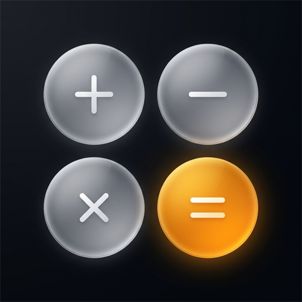

<div align="center">
  
  <h1>اله حاسبه بي الاصول</h1>
  <p>تطبيق آلة حاسبة للموبايل بلغة <strong>Flutter</strong> بتصميم زجاجي مستوحى من واجهة iPhone الحديثة (<strong>Liquid Glass</strong>).</p>

  
  
  
</div>

---

## تحميل التطبيق (Android APK)

[-FF9F0A?style=for-the-badge&logo=android&logoColor=white)](https://raw.githubusercontent.com/ahmejklljk/-/main/apk/app-release.apk)

- **رابط التحميل المباشر:** [اضغط هنا لتحميل app-release.apk مباشرة](https://raw.githubusercontent.com/ahmejklljk/-/main/apk/app-release.apk) (`43.3 MB`)

---

## المميزات

- **تصميم Liquid Glass على طراز iPhone:**
  - أزرار دائرية زجاجية شفافة بتأثير ضبابي (`BackdropFilter`) مع حواف لامعة (`Specular Rim`) وإضاءة محيطية في الخلفية.
  - دعم الوضع الداكن (Dark Glass) والوضع الفاتح (Light Glass).
  - تخطيط متجاوب للشاشات الطولية والعرضية (Portrait & Landscape).
- **محرك حسابي دقيق (`ExpressionEvaluator`):**
  - يدعم أولوية العمليات الحسابية، والأقواس الذكية `( )`، والضرب الضمني مثل `2(3+4)` و`2π`.
  - معالجة الأخطاء (القسمة على صفر، الصيغ غير الصحيحة، أخطاء المجال) بدون توقف التطبيق.
- **الوضع العلمي (`SCI`):**
  - دوال مثلثية (`sin`, `cos`, `tan`) مع التبديل بين `DEG` و`RAD`.
  - `ln`, `log`, `√`, `^`, `π`, `e`, المضروب `!`, و`x²`.
- **معاينة فورية وسجل العمليات (`History`):**
  - عرض الناتج المباشر أثناء الكتابة.
  - نافذة زجاجية لسجل العمليات السابقة مع إمكانية إعادة استخدام الناتج أو المعادلة، ونسخ النتيجة للحافظة.

---

## هيكل المشروع

```text
lib/
├── main.dart                          # نقطة التشغيل وإدارة الثيم الليلي/النهاري
├── logic/
│   ├── expression_evaluator.dart      # محلل ومقيّم المعادلات الرياضية
│   └── calculator_controller.dart     # إدارة الحالة، السجل، والعمليات
├── screens/
│   └── calculator_screen.dart         # الشاشة الرئيسية وتخطيط الأزرار
├── theme/
│   └── app_theme.dart                 # ألوان ورموز تصميم Liquid Glass
└── widgets/
    ├── calculator_button.dart         # زر زجاجي دائري بحركة ضغط تفاعلية
    ├── calculator_logo.dart           # شعار التطبيق
    ├── display_panel.dart             # شاشة العرض والمعاينة الفورية
    ├── history_sheet.dart             # نافذة سجل الحسابات
    └── liquid_glass_background.dart   # خلفية الإضاءة المحيطية
```

---

## التشغيل والاختبار

```bash
# تثبيت الاعتماديات
flutter pub get

# فحص الكود وتشغيل الاختبارات
flutter analyze
flutter test

# تشغيل على الموبايل أو المتصفح
flutter run
flutter run -d chrome

# بناء ملف APK للأندرويد
flutter build apk --release
```
